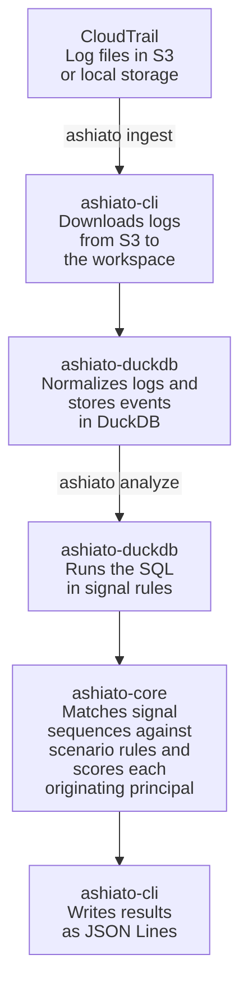

# ashiato

ashiato is a self-hosted audit log analysis tool for AWS CloudTrail. It runs open detection rules repeatedly against historical logs stored in S3. Detection results can carry [MITRE ATT&CK v20](https://attack.mitre.org/resources/updates/) technique IDs.

## Why ashiato

The first copy of CloudTrail management events can be delivered to S3 without [CloudTrail charges](https://aws.amazon.com/cloudtrail/pricing/), so it is easy to start accumulating audit logs in S3. However, Amazon GuardDuty and Amazon Athena, AWS services for threat detection and log queries, charge by the amount of data they process, and costs grow with log volume and query count.

GuardDuty charges for analyzing CloudTrail management events by event volume: in [AWS's pricing example](https://aws.amazon.com/guardduty/pricing/), 40 million events per month cost $160. It also [analyzes only the activity that starts after it is enabled](https://aws.amazon.com/guardduty/faqs/), so activity before that point goes unexamined.

To examine historical logs, you can query them in S3 with Athena. Athena charges for the data it scans, which is $5 per TB in [AWS's pricing example](https://aws.amazon.com/athena/pricing/). Investigations repeat queries with changing conditions, so 10 full scans of 1 TB of compressed logs would cost $50. Partitioning reduces the data scanned, but it must be set up before the investigation starts. Prices are as of November 2026 and vary by Region.

In short, GuardDuty cannot examine logs from before it was enabled, and Athena charges again for every new query. Repeated investigation of historical logs needs a way to change the detection conditions and time range without a charge per query. ashiato ingests logs into your own environment and analyzes that data, so changing the conditions or time range incurs no service charge based on event volume or query count.

## Comparison with other tools

The table reflects each tool as of November 2026.

| | ashiato | Amazon GuardDuty | Amazon Athena | [Suzaku](https://github.com/Yamato-Security/suzaku) |
|---|---|---|---|---|
| Runs on | Your own environment | AWS managed service | AWS managed service | Your own environment |
| Main costs | Compute, S3 reads | Fee based on data analyzed | Fee based on data scanned | Compute, log retrieval |
| Log sources | CloudTrail | CloudTrail, VPC Flow Logs, DNS logs, and more | Logs in S3 | CloudTrail, Azure, Entra ID, M365, Google Workspace |
| Historical log analysis | Yes, if the log files are available | No, only activity after it is enabled | Yes, if the logs are in S3 | Yes, if the log files are available |
| Continuous monitoring | No | Yes | No | No |
| Detection logic | 65 built-in YAML and SQL rules | Provided by AWS | SQL written by the user | 796 Sigma rules |
| Attack sequence detection | Rules that match sequences of operations | Extended Threat Detection | SQL written by the user | Sigma correlation rules |

GuardDuty suits continuous monitoring, Suzaku suits investigating logs from multiple cloud services, and ashiato suits repeatedly analyzing CloudTrail logs accumulated in S3 with rules adapted to your organization.

## What ashiato solves

- **No volume-based detection fees:** Detects suspicious operations in your own environment, where event volume adds no service charge.
- **Retroactive detection:** Covers any logs still in S3, including periods before GuardDuty was enabled.
- **Repeat analysis without query fees:** Reanalyzes ingested logs with different detection conditions and time ranges at no charge per query.
- **Parallel ingestion:** Splits log ingestion across multiple worker processes in the distributed mode of `ashiato run`.
- **Rule-based detection of chained operations:** Detects linked operations, such as a login without MFA followed by a compute launch, as one attack and traces them to the originating principal, such as an IAM user.
- **Detection as code:** Publishes detection logic as YAML and SQL rules that each organization can change.

ashiato adds no service fee of its own, but reading logs incurs S3 request and data transfer charges, and you provide the compute that runs it.

### What ashiato does not solve

ashiato is not a complete replacement for GuardDuty.

- ashiato analyzes only CloudTrail logs, not VPC Flow Logs, DNS logs, or runtime behavior.
- ashiato does not consult external threat intelligence and detects only what the rules describe.
- ashiato does not run as a daemon: it analyzes the specified period and exits, and it sends no notifications.
- Rules that require S3 data events cannot run unless your trail records them. Delivering data events incurs CloudTrail charges.

## How it works

ashiato's detection is rule-based, and it ships with 56 signal rules and 9 scenario rules. A signal rule uses SQL to find a suspicious operation. For example, `cloudtrail_logging_disabled` finds successful `StopLogging` and `DeleteTrail` calls. A scenario rule matches a sequence of signals. For example, `console_takeover_mining` matches when compute resources are launched within one hour of a console login without MFA.

ashiato processes logs through the following components and stores events in a workspace, the directory that holds the DuckDB file. `ingest` loads logs into the workspace, and `analyze` analyzes the ingested events.



`ingest` skips files it has already ingested.

`ashiato run`, which handles large datasets, processes logs through a different path from this diagram. See [`examples/pipeline/README.md`](examples/pipeline/README.md) for details.

ashiato skips rules whose required data is missing and reports them as `rule_skipped` records. These records show whether an empty result means that nothing was found or that a rule could not run.

### Security framework support

A ruleset lists the rules to run. By default, ashiato runs the `default` ruleset, which contains 42 rules.

Running a ruleset tied to a framework adds that framework's item IDs to detection results. ashiato ships with the `attack-v20` ruleset for MITRE ATT&CK v20, which maps 64 rules to 46 techniques and sub-techniques. The mapping is published as a file, so you can check how each rule relates to each technique. However, a mapping does not mean that every procedure of that technique is detected.

## Usage

The following example assumes that `ashiato` and `jq` are installed. It uses the bundled sample logs, so no AWS account is required. The sample contains a console login without MFA and a `StopLogging` call.

Run the following from the repository root.

```sh
./examples/pipeline/make-logs.sh /tmp/ashiato-demo/logs
ashiato ingest --workspace /tmp/ashiato-demo/case --source /tmp/ashiato-demo/logs
ashiato analyze --workspace /tmp/ashiato-demo/case \
  --since 2026-10-01 --until 2026-10-02 --emit-signals \
  | jq -c 'select(.type == "signal") | {signal_id, severity, region, start_time}'
```

The command prints one line for each detected signal.

```json
{"signal_id":"console_login_without_mfa","severity":"medium","region":"us-east-1","start_time":"2026-10-01T10:01:00Z"}
{"signal_id":"cloudtrail_logging_disabled","severity":"high","region":"ap-northeast-1","start_time":"2026-10-01T10:07:00Z"}
```

To analyze your own logs, set `--source` to `s3://<bucket>/AWSLogs/` and set `--since` and `--until` to the period to analyze. ashiato reads S3 credentials through the AWS SDK's default credential chain.
