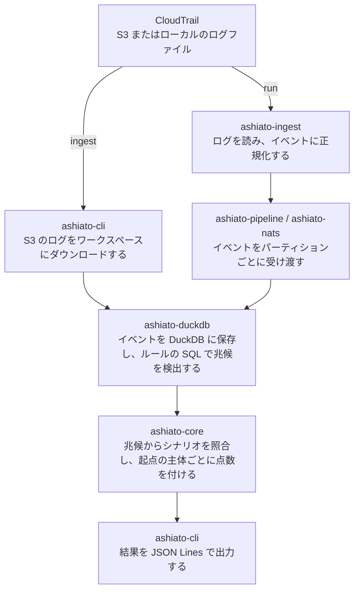

# ashiato

ashiato は、AWS CloudTrail ログを分析する self-hosted の監査ログ分析ツールである。S3 に保存された過去のログに対して、公開された検知ルールを自前の環境で繰り返し実行できる。検知結果には [MITRE ATT&CK v20](https://attack.mitre.org/resources/updates/) の技術の ID を付けられる。

## なぜ開発するのか

CloudTrail の管理イベントは、最初のコピーであれば [CloudTrail の料金](https://aws.amazon.com/cloudtrail/pricing/)なしで S3 に配信できる。そのため、監査ログを S3 に貯めること自体は始めやすい。しかし、貯めたログを検知や調査に使おうとすると、ログの量や調査の回数に応じて費用が増えていく。

検知に Amazon GuardDuty を使う場合、費用は分析したイベントの量で決まる。[AWS の料金例](https://aws.amazon.com/guardduty/pricing/)では、4,000 万件の CloudTrail 管理イベントの分析に月 160 ドルかかる。さらに、GuardDuty は[有効にした後の活動だけを分析する](https://aws.amazon.com/guardduty/faqs/)ので、有効にする前のログは検知の対象にならない。

過去のログを調べるには、Amazon Athena で S3 のログを検索する方法がある。Athena の費用は読み取ったデータ量で決まり、[AWS の料金例](https://aws.amazon.com/athena/pricing/)では 1 TB あたり 5 ドルである。調査では条件を変えて検索を繰り返すので、圧縮後で 1 TB のログを全件読み取る検索を 10 回実行すると 50 ドルかかる。パーティションを設定すれば読み取る範囲を狭められるが、そのための準備が調査の前に必要になる。ここまでの料金は 2026 年 11 月時点の情報で、リージョンによって異なる。

このように、GuardDuty では過去のログを検知にかけられず、Athena では条件を変えて調べ直すたびに費用が増える。過去のログを繰り返し調べるには、一度用意したログに対して、検知の条件と期間を検索の料金なしで変えられる手段が必要である。ashiato は、ログを手元に取り込み、以後の分析をそのデータに対して実行する。条件や期間を変えても、イベントの量や検索の回数に応じたサービスの料金はかからない。

## 他のツールとの比較

| | ashiato | Amazon GuardDuty | Amazon Athena | [Suzaku](https://github.com/Yamato-Security/suzaku) |
|---|---|---|---|---|
| 実行環境 | 自前の環境 | AWS のマネージドサービス | AWS のマネージドサービス | 自前の環境 |
| 主な費用 | 計算資源、S3 の読み取り | 分析したデータ量に応じた料金 | 読み取ったデータ量に応じた料金 | 計算資源、ログの取得 |
| 対象のログ | CloudTrail | CloudTrail、VPC フローログ、DNS ログなど | S3 上のログ | CloudTrail、Azure、Entra ID、M365、Google Workspace |
| 有効にする前のログの分析 | できる | できない | できる | ログファイルがあればできる |
| 常時の監視 | しない | する | しない | しない |
| 検知の条件 | YAML と SQL の組み込みルール 65 個 | AWS が提供する | 利用者が SQL を書く | Sigma ルール |
| 攻撃の連鎖の検知 | シナリオのルール | Extended Threat Detection | 利用者が SQL を書く | Sigma の相関ルール |

常時の監視が必要なら GuardDuty が適している。複数のクラウドのログを調べたい場合は Suzaku が適している。ashiato は、S3 に貯めた CloudTrail ログを、組織に合わせたルールで繰り返し分析したい場合に適している。

## ashiato が解決すること

- イベントの量に応じた検知サービスの料金なしで、CloudTrail ログを検知にかける。
- S3 に残っているログを、GuardDuty を有効にする前の期間も含めて検知にかける。
- 一度取り込んだログを、期間や条件を変えて、検索の料金なしで何度でも分析する。
- パイプラインでは、複数の取り込みワーカーに分担させて大量のログを取り込む。
- MFA を使わないログインの後に計算資源を起動するといった、連動した複数の操作を一連の攻撃として検出し、起点の主体を見つける。
- 検知の条件を YAML と SQL のルールとして公開し、組織ごとの変更に対応する。

分析にサービスの料金はかからないが、S3 からログを読み取るリクエストとデータ転送の料金、ashiato を実行する計算資源の費用はかかる。

### 解決しないこと

ashiato は GuardDuty を完全に置き換えるものではない。

- ashiato は CloudTrail ログだけを分析する。VPC フローログ、DNS ログ、実行環境の挙動は分析しない。
- ashiato は外部の脅威情報を参照せず、ルールに書いた条件だけを検知する。
- ashiato は常駐しない。指定した期間を分析して終了する。通知の機能もない。
- S3 のデータイベントを必要とするルールは、証跡でデータイベントを記録していなければ実行できない。データイベントの配信には CloudTrail の料金がかかる。

## どうやって解決するのか

ashiato は、次のコンポーネントを経由してログを処理する。取り込みの経路は、取り込みと分析を別々に実行する `ingest` と、1 回の実行で両方を行う `run` の 2 つがある。



ワークスペースは、取り込んだイベントを保存するディレクトリである。取り込み済みのファイルは次回の取り込みで読み飛ばす。

ルールには 2 種類ある。兆候（signal）のルールは、不審な操作を SQL で検出する。たとえば `cloudtrail_logging_disabled` は、`StopLogging` や `DeleteTrail` の成功を検出する。シナリオ（scenario）のルールは、複数の兆候の並びを照合する。たとえば `console_takeover_mining` は、MFA を使わないコンソールへのログインから 1 時間以内に計算資源が起動された場合に一致する。

現在は 56 個の兆候のルールと 9 個のシナリオのルールを組み込んでいる。

必要なデータがないルールは実行せず、`rule_skipped` 記録として出力する。結果が空だった場合に、攻撃がなかったのか、検査できなかったのかを区別するためである。

### セキュリティフレームワークへの対応

ルールセットは、実行するルールを選んで列挙した定義である。何も指定しなければ、42 個のルールを含む `default` ルールセットを実行する。

フレームワークに対応したルールセットで実行すると、検知結果にそのフレームワークの項目の ID が付く。現在は MITRE ATT&CK v20 に対応した `attack-v20` ルールセットを組み込んでいて、64 個のルールを 46 件の技術とサブ技術に対応付けている。対応はファイルとして公開しているので、どのルールがどの技術に対応するかを確認できる。これは、対応付けた技術のすべての手口を検知できることを意味しない。

## 使い方

同梱のサンプルのログを使うので、AWS のアカウントは必要ない。サンプルには、MFA を使わないログインと証跡の停止が記録されている。出力の絞り込みには `jq` を使う。

リポジトリのルートで次を実行する。

```sh
./examples/pipeline/make-logs.sh /tmp/ashiato-demo/logs
ashiato ingest --workspace /tmp/ashiato-demo/case --source /tmp/ashiato-demo/logs
ashiato analyze --workspace /tmp/ashiato-demo/case \
  --since 2026-10-01 --until 2026-10-02 --emit-signals \
  | jq -c 'select(.type == "signal") | {signal_id, severity, region, start_time}'
```

検出した兆候が 1 行ずつ出力される。

```json
{"signal_id":"console_login_without_mfa","severity":"medium","region":"us-east-1","start_time":"2026-10-01T10:01:00Z"}
{"signal_id":"cloudtrail_logging_disabled","severity":"high","region":"ap-northeast-1","start_time":"2026-10-01T10:07:00Z"}
```

自分のログを分析するときは、`--source` に `s3://<バケット>/AWSLogs/` を指定し、`--since` と `--until` に分析する期間を指定する。

## ドキュメント

- [検知結果の分析の手順](docs/analysis-method.md)
- [ルールセット](docs/rulesets.md)
- [分散配置でのパイプラインの実行例](examples/pipeline/README.md)
- 開発者向けの試験の手順：[結合テスト](docs/integration-testing.md)、[S3](docs/s3-testing.md)、[NATS](docs/nats-testing.md)、[flaws.cloud のデータセット](docs/flaws-cloud.md)
