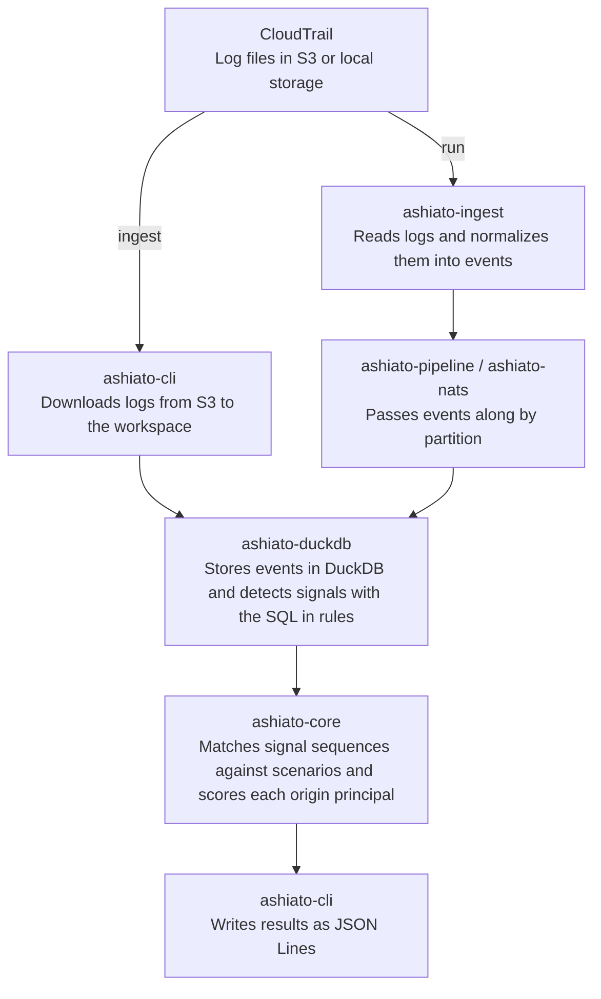

# ashiato

ashiato is a self-hosted audit log analysis tool for AWS CloudTrail logs. It runs open detection rules repeatedly against historical logs stored in S3. Detection results can carry [MITRE ATT&CK v20](https://attack.mitre.org/resources/updates/) technique IDs.

## Why ashiato

The first copy of CloudTrail management events can be delivered to S3 without [CloudTrail charges](https://aws.amazon.com/cloudtrail/pricing/), so it is easy to start accumulating audit logs in S3. However, detecting and investigating with AWS services costs more as the log volume and the number of investigations grow.

When you detect with Amazon GuardDuty, the charge for analyzing CloudTrail management events depends on the event volume. In [AWS's pricing example](https://aws.amazon.com/guardduty/pricing/), analyzing 40 million management events per month costs $160. In addition, GuardDuty [analyzes only the activity that starts after it is enabled](https://aws.amazon.com/guardduty/faqs/), so logs from before that point are not covered by its detection.

To look at historical logs, you can search them in S3 with Amazon Athena. Athena's charge depends on the amount of data scanned, and [AWS's pricing example](https://aws.amazon.com/athena/pricing/) uses $5 per TB. Investigations repeat searches with changing conditions. Running a search that scans all of 1 TB of compressed logs 10 times comes to $50. Partitioning narrows the range to scan, but that preparation has to happen before the investigation. The prices above are as of November 2026 and vary by Region.

In short, GuardDuty cannot cover logs from before it was enabled, and Athena costs more each time you search again with different conditions. Investigating historical logs repeatedly requires a way to change the detection conditions and time range on logs you have already prepared, without search charges. ashiato ingests logs into your own environment and runs subsequent analysis against that data. Changing the detection conditions or time range incurs no service charges based on event volume or search count.

## Comparison with other tools

| | ashiato | Amazon GuardDuty | Amazon Athena | [Suzaku](https://github.com/Yamato-Security/suzaku) |
|---|---|---|---|---|
| Runs on | Your own environment | AWS managed service | AWS managed service | Your own environment |
| Main costs | Compute, S3 reads | Charged by data analyzed | Charged by data scanned | Compute, log retrieval |
| Log sources | CloudTrail | CloudTrail, VPC Flow Logs, DNS logs, and more | Logs in S3 | CloudTrail, Azure, Entra ID, M365, Google Workspace |
| Historical log analysis | Yes, if the log files are available | Does not analyze logs from before it was enabled | Yes, if the logs are in S3 | Yes, if the log files are available |
| Continuous monitoring | No | Yes | No | No |
| Detection logic | 65 built-in YAML and SQL rules | Provided by AWS | SQL written by the user | 796 Sigma rules |
| Attack sequence detection | Scenario rules | Extended Threat Detection | SQL written by the user | Sigma correlation rules |

GuardDuty suits continuous monitoring, Suzaku suits investigating logs from multiple clouds, and ashiato suits repeatedly analyzing CloudTrail logs accumulated in S3 with rules adapted to your organization.

## What ashiato solves

- Detects suspicious operations in CloudTrail logs without detection service charges based on event volume.
- Covers any logs remaining in S3, including periods before GuardDuty was enabled.
- Analyzes ingested logs as many times as needed, with different detection conditions and time ranges, without search charges.
- Distributes log ingestion across multiple worker processes in the distributed placement of `ashiato run`.
- Detects linked operations, such as launching compute resources after a login without MFA, as a single attack, and finds the principal at their origin (such as an IAM user).
- Publishes detection logic as YAML and SQL rules, and supports changes for each organization.

Analysis incurs no service charges, but S3 requests and data transfer for reading the logs, and the compute that runs ashiato, are still billed.

### What ashiato does not solve

ashiato is not a complete replacement for GuardDuty.

- ashiato analyzes only CloudTrail logs, not VPC Flow Logs, DNS logs, or runtime behavior.
- ashiato does not consult external threat intelligence and detects only what the rules describe.
- ashiato does not run as a daemon. It analyzes the specified period and exits. It has no notification feature either.
- Rules that require S3 data events cannot run unless your trail records them. Delivering data events incurs CloudTrail charges.

## How it works

ashiato detects with rules. There are two kinds, and it currently ships with 56 signal rules and 9 scenario rules. Signal rules detect a suspicious operation with SQL. For example, `cloudtrail_logging_disabled` detects successful `StopLogging` and `DeleteTrail` calls. Scenario rules match a sequence of signals. For example, `console_takeover_mining` matches when compute resources are launched within one hour of a console login without MFA.

ashiato processes logs through the following components and stores events in a workspace (the directory that holds the DuckDB file). The path differs between ingesting with `ingest` and then analyzing with `analyze`, and doing both in one execution with `run`.



`ingest` skips files that it has already ingested on the next execution.

Rules whose required data is missing are not run, and are reported as `rule_skipped` records. This distinguishes an empty result that means no attack was found from one that means the check could not run.

### Security framework support

A ruleset is a definition that selects and lists the rules to run. If you specify nothing, ashiato runs the `default` ruleset, which contains 42 rules.

Running a ruleset tied to a framework adds that framework's item IDs to detection results. ashiato currently ships with the `attack-v20` ruleset for MITRE ATT&CK v20, which maps 64 rules to 46 techniques and sub-techniques. The mapping is published as a file, so you can check how each rule relates to each technique. However, a mapping does not mean that every procedure of that technique is detected.

## Usage

The following example assumes that `ashiato` and `jq` are installed. It uses the bundled sample logs, so no AWS account is required. The sample contains a login without MFA and a trail being stopped.

Run the following from the repository root.

```sh
./examples/pipeline/make-logs.sh /tmp/ashiato-demo/logs
ashiato ingest --workspace /tmp/ashiato-demo/case --source /tmp/ashiato-demo/logs
ashiato analyze --workspace /tmp/ashiato-demo/case \
  --since 2026-10-01 --until 2026-10-02 --emit-signals \
  | jq -c 'select(.type == "signal") | {signal_id, severity, region, start_time}'
```

Each detected signal is printed on its own line.

```json
{"signal_id":"console_login_without_mfa","severity":"medium","region":"us-east-1","start_time":"2026-10-01T10:01:00Z"}
{"signal_id":"cloudtrail_logging_disabled","severity":"high","region":"ap-northeast-1","start_time":"2026-10-01T10:07:00Z"}
```

To analyze your own logs, set `--source` to `s3://<bucket>/AWSLogs/`, and set `--since` and `--until` to the period to analyze. S3 credentials are read through the default method of the AWS SDK.

## Documentation

The following documents are written in Japanese.

- [Analyzing detection results](docs/analysis-method.md)
- [Rulesets](docs/rulesets.md)
- [Running the pipeline in a distributed placement](examples/pipeline/README.md)
- Testing guides for developers: [integration testing](docs/integration-testing.md), [S3](docs/s3-testing.md), [NATS](docs/nats-testing.md), [the flaws.cloud dataset](docs/flaws-cloud.md)
