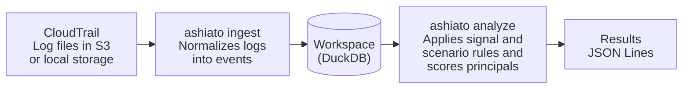

# ashiato

ashiato is a self-hosted audit log analysis tool for AWS CloudTrail. It runs open detection rules repeatedly against historical logs stored in S3. Detection results can carry [MITRE ATT&CK v20](https://attack.mitre.org/resources/updates/) technique IDs.

## Why ashiato

The first copy of CloudTrail management events can be delivered to S3 without [CloudTrail charges](https://aws.amazon.com/cloudtrail/pricing/), so it is easy to start accumulating audit logs in S3. However, Amazon GuardDuty and Amazon Athena, AWS services for threat detection and log queries, charge by the amount of data they process, and costs grow with log volume and query count.

GuardDuty charges for analyzing CloudTrail management events by event volume: in [AWS's pricing example](https://aws.amazon.com/guardduty/pricing/), 40 million events per month cost $160. It also [analyzes only the activity that starts after it is enabled](https://aws.amazon.com/guardduty/faqs/), so activity before that point goes unexamined.

To examine historical logs, you can query them in S3 with Athena. Athena charges for the data it scans, which is $5 per TB in [AWS's pricing example](https://aws.amazon.com/athena/pricing/). Investigations repeat queries with changing conditions, so 10 full scans of 1 TB of compressed logs would cost $50. Partitioning reduces the data scanned, but it must be set up before the investigation starts. Prices are as of November 2026 and vary by Region.

In short, GuardDuty cannot examine logs from before it was enabled, and Athena charges again for every new query. Repeated investigation of historical logs needs a way to change the detection conditions and time range without a charge per query. ashiato ingests logs into your own environment and analyzes that data, so changing the conditions or time range incurs no service charge based on event volume or query count.

## Comparison with other tools

The table reflects each tool as of November 2026.

| | ashiato | Amazon GuardDuty | Amazon Athena | [Suzaku](https://github.com/Yamato-Security/suzaku) |
|---|---|---|---|---|
| Runs on | Your own environment | AWS managed service | AWS managed service | Your own environment |
| Main costs | Compute, S3 reads | Fee based on data analyzed | Fee based on data scanned | Compute, log retrieval |
| Log sources | CloudTrail | CloudTrail, VPC Flow Logs, DNS logs, and more | Logs in S3 | CloudTrail, Azure, Entra ID, M365, Google Workspace |
| Historical log analysis | Yes, if the log files are available | No, only activity after it is enabled | Yes, if the logs are in S3 | Yes, if the log files are available |
| Continuous monitoring | No | Yes | No | No |
| Detection logic | 65 built-in YAML and SQL rules | Provided by AWS | SQL written by the user | 796 Sigma rules |
| Attack sequence detection | Rules that match sequences of operations | Extended Threat Detection | SQL written by the user | Sigma correlation rules |

GuardDuty suits continuous monitoring, Suzaku suits investigating logs from multiple cloud services, and ashiato suits repeatedly analyzing CloudTrail logs accumulated in S3 with rules adapted to your organization.

## What ashiato solves

- **No volume-based detection fees:** Detects suspicious operations in your own environment, where event volume adds no service charge.
- **Retroactive detection:** Covers any logs still in S3, including periods before GuardDuty was enabled.
- **Repeat analysis without query fees:** Reanalyzes ingested logs with different detection conditions and time ranges at no charge per query.
- **Parallel ingestion:** Ingests log files in parallel with the `--jobs` option of `ashiato ingest`.
- **Rule-based detection of chained operations:** Detects linked operations, such as a login without MFA followed by a compute launch, as one attack and traces them to the originating principal, such as an IAM user.
- **Detection as code:** Publishes detection logic as YAML and SQL rules that each organization can change.

ashiato adds no service fee of its own, but reading logs incurs S3 request and data transfer charges, and you provide the compute that runs it.

### What ashiato does not solve

ashiato is not a complete replacement for GuardDuty.

- ashiato analyzes only CloudTrail logs, not VPC Flow Logs, DNS logs, or runtime behavior.
- ashiato does not consult external threat intelligence and detects only what the rules describe.
- ashiato does not run as a daemon: it analyzes the specified period and exits, and it sends no notifications.
- Rules that require S3 data events cannot run unless your trail records them. Delivering data events incurs CloudTrail charges.

## How it works

ashiato's detection is rule-based, and it ships with 56 signal rules and 9 scenario rules. A signal rule uses SQL to find a suspicious operation. For example, `cloudtrail_logging_disabled` finds successful `StopLogging` and `DeleteTrail` calls. A scenario rule matches a sequence of signals. For example, `console_takeover_mining` matches when compute resources are launched within one hour of a console login without MFA.

ashiato processes logs with two commands. `ingest` converts logs into events and stores them in a workspace, the directory that holds the DuckDB file, and `analyze` analyzes the stored events.



`ingest` skips files it has already ingested.

For processing large datasets, see [`examples/pipeline/README.md`](examples/pipeline/README.md).

ashiato skips rules whose required data is missing and reports them as `rule_skipped` records. These records show whether an empty result means that nothing was found or that a rule could not run.

### Security framework support

A ruleset lists the rules to run. By default, ashiato runs the `default` ruleset, which contains 42 rules.

Running a ruleset tied to a framework adds that framework's item IDs to detection results. ashiato ships with the `attack-v20` ruleset for MITRE ATT&CK v20, which maps 64 rules to 46 techniques and sub-techniques. The mapping is published as a file, so you can check how each rule relates to each technique. However, a mapping does not mean that every procedure of that technique is detected.

## Installation

[GitHub Releases](https://github.com/donkomura/ashiato/releases) provides archives for Linux on x86_64 and arm64. The archives are built on Ubuntu 26.04, so they need a glibc at least as new as the one in that release.

```sh
version=0.1.0
target=x86_64-unknown-linux-gnu
curl -fsSLO "https://github.com/donkomura/ashiato/releases/download/v$version/ashiato-$version-$target.tar.gz"
tar -xzf "ashiato-$version-$target.tar.gz"
export PATH="$PWD/ashiato-$version-$target/bin:$PATH"
```

`bin/ashiato` loads `lib/libduckdb.so` from the same archive by a relative path, so keep `bin` and `lib` side by side.

## Usage

The following example assumes that `ashiato` and `jq` are installed. It uses the bundled sample logs, so no AWS account is required. The sample contains a console login without MFA and a `StopLogging` call.

Run the following from the repository root.

```sh
./examples/pipeline/make-logs.sh /tmp/ashiato-demo/logs
ashiato ingest --workspace /tmp/ashiato-demo/case --source /tmp/ashiato-demo/logs
ashiato analyze --workspace /tmp/ashiato-demo/case \
  --since 2026-10-01 --until 2026-10-02 --emit-signals \
  | jq -c 'select(.type == "signal") | {signal_id, severity, region, start_time}'
```

The command prints one line for each detected signal.

```json
{"signal_id":"console_login_without_mfa","severity":"medium","region":"us-east-1","start_time":"2026-10-01T10:01:00Z"}
{"signal_id":"cloudtrail_logging_disabled","severity":"high","region":"ap-northeast-1","start_time":"2026-10-01T10:07:00Z"}
```

To analyze your own logs, set `--source` to `s3://<bucket>/AWSLogs/` and set `--since` and `--until` to the period to analyze. ashiato reads S3 credentials through the AWS SDK's default credential chain.

### Filtering results

An account with many detections produces more output than you can read record by record. Start with a summary to see the overall picture, then narrow down to individual records, beginning with the highest severity.

`--severity` outputs only signals and scenario matches of the listed severities (`low`, `medium`, `high`, `critical`). `--summary` groups them by kind, rule ID, and originating principal into one `summary` record per group, which replaces the individual records. `summary` records are sorted by severity, highest first, then by count, largest first. Signals are included in the summary, so `--emit-signals` is not needed.

```sh
ashiato analyze --workspace case --since 2026-09-01 --until 2026-10-01 \
  --summary --severity critical,high
```

| Key | Meaning |
|---|---|
| `kind` | `signal` or `scenario_match` |
| `rule_id`, `severity`, `origin` | The rule and originating principal of the group |
| `count` | Number of signals or scenario matches in the group |
| `first_seen`, `last_seen` | Times of the first and last evidence events |
| `source_ips` | Number of source IP addresses in the evidence |
| `events` | Number of distinct evidence events |

Separate attacks on the same principal can end up in one line. A line with a long span between `first_seen` and `last_seen`, or with many `source_ips`, may contain several attacks. To separate them, filter the `--emit-signals` output by rule and principal, then compare source IP addresses and times.

```sh
ashiato analyze --workspace case --since 2026-09-01 --until 2026-10-01 \
  --emit-signals --severity critical,high \
  | jq -c 'select(.type == "signal" and .signal_id == "compute_launch_attempts"
                  and .origin.id == "iam_user:arn:aws:iam::111111111111:user/alice")
           | {start_time, source_ip, attrs}'
```

You can look up evidence events by `event_id` in the `events` table of `ashiato.duckdb` in the workspace.

Work done by the account owner also produces signals. To tell whether an operation came from the owner, check whether the source IP address was used during the baseline period and whether the owner performed other operations at the same time.

`rule_skipped` records are output even with `--summary` or `--severity`. The `data` field of the `run` record holds the number of events in the analysis period (`events`) and whether S3 data events exist (`s3_data_events`).

### Selecting rulesets

If you specify neither a ruleset nor a rule, ashiato runs the `default` ruleset.

| Option | Meaning |
|---|---|
| `--ruleset <id>[,<id>...]` | Rulesets to run. With several rulesets, ashiato runs the union of their rules |
| `--rule <id>[,<id>...]` | Narrows the selected rulesets to these rules. Specifying a scenario also runs the signals of its steps. Specifying a rule outside the rulesets is an error |
| `--rulesets <dir>` | Directory of manifests to read in addition to the embedded rulesets. A manifest with the same ID replaces the existing ruleset |
| `--rules <dir>` | Adds rules and replaces rules with the same ID. Added rules that belong to no ruleset join `default` |

`ashiato rulesets list` lists the rulesets. `ashiato rulesets show <id>` outputs the ID, kind, severity, tactic, and `refs` of each rule in a ruleset. Both commands output JSON Lines.

When a ruleset has a framework, `signal` and `scenario_match` records carry the matching item IDs in `refs`.

```json
{"type":"signal","signal_id":"cloudtrail_logging_disabled","refs":[{"ruleset":"attack-v20","ids":["T1685.002"]}]}
```

A ruleset manifest looks like the following. `framework` and `refs` are optional, and `refs` is allowed only in a ruleset with a `framework`. `framework.kind` accepts only `mitre_attack`.

```yaml
id: attack-v20
title: MITRE ATT&CK v20 Enterprise (IaaS, Identity Provider)
framework:
  kind: mitre_attack
  version: "20.0"
  url: https://attack.mitre.org/versions/v20/
rules:
  - id: cloudtrail_logging_disabled
    refs: [T1685.002]
```

The signals that a scenario's steps refer to must be in the same ruleset as the scenario. `ashiato rules validate` also checks that a ruleset lists no missing rules and that no scenario lacks its signals. `ashiato rules test --ruleset <id>` tests only the fixtures of the rules in that ruleset.

## Testing

`cargo test --workspace` runs the tests that need neither Docker nor an external dataset. The tests that do are marked `#[ignore]`. Run them with the following commands.

```sh
cargo test -p ashiato-ingest --test s3 -- --ignored
cargo test -p ashiato-cli --test run_s3 -- --ignored
cargo test -p ashiato-nats -- --ignored
cargo test -p ashiato-cli --test distributed --test distributed_failures --test example_pipeline -- --ignored
cargo test -p xtask -- --ignored
```

These tests need Docker. Each test starts its own containers and removes them when it ends. The images are pinned in `crates/ashiato-testkit/src/minio.rs` and `crates/ashiato-testkit/src/nats.rs`. If a test process is killed, containers can remain. Remove them with the following commands.

```sh
docker rm --force $(docker ps --quiet --filter label=ashiato-test=minio)
docker rm --force $(docker ps --quiet --filter label=ashiato-test=nats)
```

### Test with the flaws.cloud dataset

`crates/ashiato-cli/tests/flaws.rs` puts the flaws.cloud CloudTrail logs [published by Summit Route](https://summitroute.com/blog/2020/10/09/public_dataset_of_cloudtrail_logs_from_flaws_cloud/) into MinIO and runs `ashiato run` to completion. The dataset is not in the repository, so download it first.

```sh
mkdir -p ~/datasets/flaws && cd ~/datasets/flaws
curl -LO https://summitroute.com/downloads/flaws_cloudtrail_logs.tar
tar -xf flaws_cloudtrail_logs.tar
```

```sh
ASHIATO_FLAWS_DIR=~/datasets/flaws/flaws_cloudtrail_logs \
  cargo test --release -p ashiato-cli --test flaws -- --ignored --nocapture
```

To change the analysis period, set the environment variables `ASHIATO_FLAWS_SINCE` and `ASHIATO_FLAWS_UNTIL`.

### Integration tests of the distributed placement

`cargo xtask integration` runs the ingest workers, the NATS server, the analysis consumer, and MinIO in separate containers with Docker Compose. It needs Docker Compose v2 and a CPU with at least 6 physical cores.

```sh
cargo xtask integration correctness --dataset a
cargo xtask integration correctness --dataset a-no-data-events
cargo xtask integration scaling --dataset b --workers 1,2,3,4 --repeat 3
```

`correctness` compares each run, including runs with injected failures, against a reference run and writes a report to `target/integration/report.md`. `scaling` measures ingestion speed for each number of workers and writes a report to `target/integration/scaling-report.md`. Both exit with a nonzero status if a run fails its criteria. To shrink the dataset, pass an option such as `--scale 0.01`.

The MinIO volumes that hold the datasets stay for the next run. Remove them when you no longer need them.

```sh
docker volume rm $(docker volume ls --quiet --filter label=ashiato-integration=minio)
```
